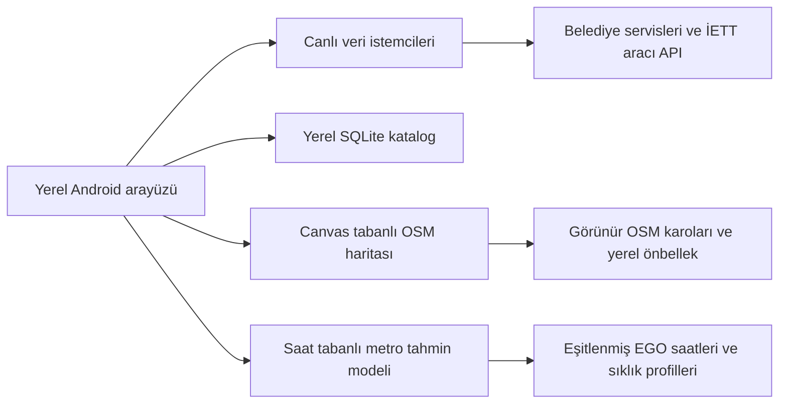

# Transit TR

Android 6+ ve Android 2.2 için yerel toplu taşıma uygulaması. OpenStreetMap üzerinde otobüs konumlarını, durakları ve hat rotalarını gösterir. Ankara ve İstanbul için ayrı metro haritası ve saate dayalı tren konumu tahminleri sunar. WebView veya Google Play Services gerektirmez.

**Sürüm: 1.2.0** · [Kaynak kod](#kaynak-kod) · [Kurulum](#kurulum) · [Test raporu](docs/WIDGET-v120.md) · [Lisans](LICENSE)


## Özellikler

- **Canlı otobüs takibi:** kaynağın sağladığı GPS konumları, varış dakikaları veya kalan durak sayısı.
- **Seçili durak işareti:** girilen durak numarasının koordinatı varsa haritada adı ve numarasıyla siyah pin gösterilir. Durak değiştirilince eski işaret ve sonuçlar temizlenir.
- **Aynı haritada renkli rota:** canlı listedeki mavi hat numarasına dokununca ilgili hat çizilir. Durak işareti korunur; üstteki rota etiketine dokunarak çizgi temizlenebilir.
- **Kaydırılabilir varış listesi:** kaynaktan gelen tüm hatlar ve araçlar aşağı kaydırılarak görülebilir.
- **Yeni katalog:** ana uygulama içinde Hatlar, Duraklar ve Kaydedilenler; arama, yıldızla kaydetme, yakın duraklar ve kaydırarak yeni sonuç yükleme.
- **Ankara sefer saatleri:** EGO'dan otobüs, metro ve Ankaray saatleri; hafta içi, cumartesi ve pazar sütunları, özel sefer notları ve yenileme.
- **Ayrı metro haritası:** Ankara ve İstanbul hatları, istasyonlar ve saate dayalı tahmini tren konumları.
- **Yerel arayüz:** Geist yazı tipi, açık/koyu tema ve dört Material menü ikonu. Android 2.2'de daha küçük karo belleği ve tek harita ağ işçisi.
- **OpenStreetMap:** sürükleme, iki parmakla yakınlaştırma, artı/eksi düğmeleri ve görünür karolar için en az 7 günlük önbellek.

Canlı takip ön planda Ankara, İzmir ve Konya için yaklaşık 20 saniyede, İstanbul için yaklaşık 60 saniyede yenilenir. Uygulama içi harita takibi arka planda durur. Widget kuruluysa görünen kayıtlar için kısa süreli yenileme işleri çalışabilir. Bağlantı hatasında önceki sonuçlar korunur ve yeniden deneme aralığı uzar.

## Ana ekran widget’ı

Ankara, İstanbul, İzmir ve Konya’dan **durak + hat çiftlerini** kaydedip launcher üzerinde varış bilgisini görebilirsiniz. İlk kullanımda örnek hat eklenmez; yalnız kullanıcının kaydettiği sorgular listelenir.

1. Canlı takip ekranındaki yıldızı veya **Katalog → Durak + hat favorileri** bağlantısını açın.
2. Şehir, durak numarası ve hat kodunu girip **Durak + hattı kaydet** düğmesine dokunun. İsterseniz kısa bir ad verin.
3. Launcher’ın widget listesinden **Transit TR · Varışlar** öğesini ana ekrana ekleyin.
4. **Yenile** ile yeni sorgu yapın. Satıra dokununca uygulama aynı şehir, durak ve hatla açılır. **Sonraki** ile diğer kayıtlara geçin.

En fazla 12 çift kaydedilebilir. Android 6+ widget’ı kenarlarından yeniden boyutlandırılabilir; küçük görünüm tek, büyük görünümler iki veya üç kayıt gösterir. Varsayılan boyut yaklaşık 4×2’dir; launcher ızgarasına göre hücre sayısı değişebilir. Android 2.2’de kompakt sabit boyut kullanılır. Küçük görünümde durak yazısına dokunarak kayıtları düzenleyebilirsiniz.

Widget ekran açıkken yaklaşık dakikada bir yenilemeyi dener; Android güç tasarrufu bu işi erteleyebilir. Her satırda son sorgu saati gösterilir; eski veya yenilenemeyen sonuçlar işaretlenir. İstanbul widget’ı tam GPS filosunu indirmeden durak varış servisini kullanır. İzmir’de kaynak yalnız durak sayısı veriyorsa dakika üretilmez; Konya’da süre yayımlanmayan bir satır için **Dakika yok** gösterilir.

## Açık ve koyu tema

**Ayarlar → Görünüm → Açık / Koyu** seçimi kaydedilir. Harita, metro, katalog, saat pencereleri, favori düzenleme ekranı ve widget’lar aynı tercihe uyar. Gece haritası mevcut OSM karolarının çizim sırasında renklendirilmesidir; ikinci bir karo seti indirilmez veya saklanmaz.

## Depolama sınırları

- Katalog: yaklaşık **5,7 MiB**; kimlikler, adlar ve koordinatlar korunur.
- Harita ve çevrimiçi rota dosyaları: birlikte **en fazla 1 MiB** önbellek bütçesi. Sınır dolunca eski önbellek girdileri kaldırılır.
- EGO güncellenmiş saatleri: ayrı yüzlerce dosya yerine **en fazla 1,25 MiB** tek sıkıştırılmış arşiv.
- 451.793 rota noktası ve 51.934 statik tarife girdisi, önceki veriyle birebir karşılaştırıldı; sıkıştırma kayıpsızdır.

8 Kasım 2026 Android 6 testinde Depolama ekranındaki toplam **42,33 MB’den yaklaşık 12,43 MB’ye** indi; önbellek ayrı olarak yaklaşık 0,98 MB gösterildi. Android’in derlenmiş kod dosyaları da dahil dosya sistemi ölçümü yaklaşık 17,2 MiB idi. İki emülatörde 20 MiB hedefi ve önbellek sınırı doğrulandı. Derlenmiş kod boyutu işletim sistemine göre değişebilir; bunlar test edilen emülatör ölçümleridir. [Widget, tema ve depolama raporu](docs/WIDGET-v120.md).

## Şehir desteği

| Şehir | Canlı bilgi | Hat haritası |
|---|---|---|
| Ankara | EGO durak/hat sorgusundan GPS ve varış dakikaları | EGO'nun sıralı durakları ve bilinen OSM koordinatlarıyla şematik bağlantı |
| İstanbul | İETT filo GPS'i ve seçilen durağa ait kaynak dakikaları | İETT / Otobüsüm Anlık güzergâh geometrisi ve hat durakları |
| İzmir | ESHOT / İZTEK GPS'i ve kalan durak sayısı | ESHOT'un yayımladığı otobüs güzergâh geometrileri |
| Konya | ATUS varış bilgileri | Mevcut GTFS güzergâh geometrileri; canlı araç GPS katmanı yok |

Kaynakta dakika bulunmadığında GPS konumu veya kalan durak sayısı dakikaya çevrilmez. Hat rotası bir aracın o anda bulunduğu konumu ifade etmez.

Ankara çizgileri **şematiktir**; koordinatı bulunan duraklar sırayla kesintisiz bağlanır, eksik durağa koordinat atanmaz. Konya GTFS verisi 2025 tarihlidir ve sonradan değişen hatları içermeyebilir. İzmir ve Konya'da bazı geometrilerin sıralı durak listesi bulunmaz. Her durak için koordinat veya her hat için çizilebilir rota garantisi yoktur. [Veri ve API kaynakları](docs/SOURCES-v1.md).

### Ankara kataloğu ve saat eşitleme

7 Kasım 2026 veri hazırlığında:

- EGO'nun **665 hat/yönü** eşitlendi; 34.657 günlük kalkış girdisi ve 52.079 sıralı durak girdisi alındı. Kaynak 20 hat için saat yayımlamıyor.
- **10.866 Ankara durak kaydının 6.501'inde koordinat** bulunuyor. EGO adları ile OSM koordinatları birleştirildi; eski favori kimlikleri korundu.
- İzmir'in resmî CSV verilerinden **11.983 otobüs durağı ve 892 hat/yön geometrisi** eklendi.

Ankara hat ekranındaki **Sefer saatleri → EGO'dan yenile** ile tek hat güncellenebilir. **Ayarlar** bölümünden tüm EGO hatları eşitlenebilir. Kaynak saatinin yanındaki özel başlangıç ve durak notları korunur; bağlantı hatasında önceki kayıt kullanılır ve belirtilir.

### İstanbul'da dakika ve GPS

Hat alanı boşken seçilen durağın yaklaşan araçları listelenir. Hat girildiğinde harita hattın filosunu, **Durağa varış** listesi ise yalnız seçilen durak ve hatta ait kaynak dakikalarını gösterir. Filo GPS kaydı dakika yerine yazılmaz.

Hat seçilen durağa uğramıyorsa bu açıkça belirtilir ve **Hat durağı seç** düğmesi açılır. Örneğin `500T`, `224672` Kadıköy Çarşı durağına uğramaz; `205471` durağıyla sorgulanabilir. Sol üstteki **Yön** menüsünden gidiş/dönüş seçilebilir. Rota açıkken üstteki etikete dokunarak önce çizgiyi temizleyin.

Otobüsüm Anlık projesinin MIT lisanslı API sözleşmeleri yerel Java koduna uyarlandı. İETT GPS sorgusunda resmî SOAP servisi önceliklidir; durak varışları, hat durakları, güzergâh ve GPS yedeği için Otobüsüm Anlık API'si kullanılır. Lisans ve uyarlama bilgileri [üçüncü taraf bildirimlerindedir](THIRD-PARTY-NOTICES.md).

### Metro haritası

Ankara M1–M4 ve Ankaray; İstanbul'da M11 dahil 25 raylı hat ve ayrı M2 Seyrantepe mekik kolu olmak üzere 26 rota görüntülenir. M5, Sultanbeyli’ye kadar 24 istasyon içerir; Marmaray (B1), B2, T2, T6, F2 ve F3 de listelenir. Hat ve istasyon seçilebilir, istasyona odaklanılabilir.

**Tren konumları saate dayalı tahmindir, GPS değildir.** Ankara modeli eşitlenen EGO kalkış saatlerini; İstanbul modeli yayımlanmış yolculuk sürelerini ve sıklık varsayımlarını kullanır. Ankara M1–M2–M3 birleşik Koru–OSB koridoru olarak hesaplanır. İstanbul'da pik sıklığın gün boyunca sabit olması, M11 için 10 dakikalık sıklık ve ara istasyonlarda 20 saniyelik bekleme model varsayımlarıdır. Gecikme, iptal ve özel gün değişiklikleri hesaba katılmaz. Ayrıntılar uygulamadaki **Model** bölümündedir; istasyon bağlantıları gerçek ray geometrisi değildir.

## Kurulum

APK indirmeleri için [Releases](https://github.com/basicos2025/transit-tr/releases) bölümünü kullanın. 1.2.0 dağıtım dosyaları:

| Dosya | Minimum Android | targetSdk |
|---|---|---:|
| `Transit-TR-v1.2.0-android6-plus.apk` | Android 6.0 / API 23 | 28 |
| `Transit-TR-v1.2.0-android22.apk` | Android 2.2 / API 8 | 8 |

Her APK yaklaşık 6,7 MiB'dir. Açılmış yerel katalog yaklaşık 5,7 MiB kullanır; rotalar ve statik tarifeler APK içinden sıkıştırılmış olarak okunur. Eski büyük katalog güncellemeden sonraki ilk çalışmada temizlenir; favori kimlikleri korunur.

İki APK aynı paket kimliğini (`org.transittr`) kullanır; aynı cihazda ayrı uygulamalar olarak kurulmaz. APK'lar test anahtarıyla imzalıdır. Üretim dağıtımında kendi kalıcı anahtarınızı kullanın. Özel anahtar kaynak paketinde bulunmaz. Android 6+ paketinin tüm yeni Android sürümlerinde ve fiziksel cihazlarda çalıştığı doğrulanmadı; Play Store yayını hazırlanmadı.

## Kullanım

1. Şehri seçin, durak numarasını yazın ve **Başlat** düğmesine dokunun.
2. Tek hat için **Hat** alanını doldurun; desteklenen sorgularda tüm hatlar için boş bırakın.
3. Alt listeyi kaydırarak diğer varışları görün. Mavi hat numarasına dokunarak rotayı açın.
4. Araç veya durak işaretine dokunarak ayrıntıyı görün. **Metro** ve **Katalog** sekmelerinden diğer ekranlara geçin.

| Şehir | Örnek sorgu |
|---|---|
| Ankara | Durak `10940`, hat boş veya `481` |
| İstanbul | Durak `224672`, hat boş; ya da durak `205471`, hat `500T` |
| İzmir | Durak `21050` |
| Konya | Durak `27` |

Sonuçlar saate, sefer durumuna ve servis erişimine göre değişir. Kaynak konum zamanı varsa ayrıntıda gösterilir; 3 dakikadan eski zaman damgalı araçlar gri çizilir. Kaynak zamanı bilinmiyorsa yeni bir konum zamanı üretilmez. Canlı sorgu için telefon GPS izni gerekmez; **Yakınımda** cihaz konumunu kullanır.

## Kaynak kod

[GitHub deposu](https://github.com/basicos2025/transit-tr) üzerinden **Code → Download ZIP** ile kaynak kodu indirebilir veya depoyu klonlayabilirsiniz:

```sh
git clone https://github.com/basicos2025/transit-tr.git
cd transit-tr
```

Hazırlanan sürüm kaynak arşivi `Transit-TR-v1.2.0-kaynak.zip` adını taşır. APK yerine kaynak ZIP'i açtığınızda aşağıdaki klasörler bulunur:

| Konum | İçerik |
|---|---|
| [android-legacy/src/org/transittr](android-legacy/src/org/transittr/) | Android 2.2 ve Android 6+ tarafından paylaşılan yerel Java kodu |
| [android-legacy/assets](android-legacy/assets/) | Katalog, metro ağı ve eşitlenmiş EGO saatleri |
| [android-tests/src/org/transittr/tests](android-tests/src/org/transittr/tests/) | Emülatör, canlı sorgu ve bellek kontrolleri |
| [tools](tools/) | APK derleme, veri üretme ve test çalıştırıcıları |
| [data](data/) | Ham veriler, kaynak özeti ve dosya karmaları |
| [web](web/) ve [backend](backend/) | Web/PWA kataloğu ve Go sunucusu |
| [docs](docs/) | Derleme, veri kaynakları, test raporları ve ekran görüntüleri |

Android uygulamasının başlangıç ekranı [TransitActivity.java](android-legacy/src/org/transittr/TransitActivity.java), harita çizimi [OsmMapView.java](android-legacy/src/org/transittr/OsmMapView.java), durak konumu çözümlemesi [StopResolver.java](android-legacy/src/org/transittr/StopResolver.java) içindedir.

### Derleme

[Android derleme rehberi](docs/BUILD-v1.md), gerekli Java/ECJ, Android SDK araçları ve imza anahtarı ortam değişkenlerini açıklar. Paylaşılan Java kodu API 8'e karşı derlenir; Android 8+ widget iş zamanlayıcısı modern pakete ayrıca eklenir. Modern derlemede API 26+ platform jar gerekir; testte API 34 kullanıldı. Gradle ve AndroidX kullanılmaz.

PowerShell'de, rehberdeki ortam değişkenlerini ayarladıktan sonra:

```powershell
# Android 6+
$env:ANDROID_VARIANT='modern'
python tools/build_android.py

# Android 2.2
$env:ANDROID_VARIANT='legacy'
python tools/build_android.py
```

Çıktılar `dist/transit-tr-v1.2.0-modern.apk` ve `dist/transit-tr-v1.2.0-legacy.apk` olur. Verileri ham kaynaklardan yeniden üretmek için `python tools/build_route_data.py` çalıştırın. Test APK'sı üretirken `ANDROID_TESTS=1` kullanılır; normal uygulamaya dönerken bu değişken kaldırılmalıdır.

Web/PWA kataloğu için Go 1.18+ ile `backend` klasöründe `go run .` çalıştırın ve `http://localhost:8080` adresini açın. Yeni yerel harita arayüzü Android APK'larındadır.

## Testler

Android 2.2/API 8 ARM ve Android 6.0/API 23 x86 emülatörlerinde canlı Ankara/İstanbul sorguları, durak işareti, aynı haritada rota, kaydırılan varış listesi, katalog araması/sayfalaması ve EGO saat yenilemesi kontrol edildi. Dört şehir için örnek durak konumu ve rota verisi test edildi. [1.1.0 test raporu](docs/TEST-REPORT-v110.md) senaryoları, PSS bellek ölçümlerini ve kapsam sınırlarını içerir. Emülatör ölçümleri fiziksel cihaz garantisi değildir.

```sh
python tests/catalog.test.py
node tests/core.test.cjs

# Uygulama ve test APK'sını önce emülatöre kurun.
python tools/run_map_tests.py emulator-5556 --test-class RoutePinCheck --output test-results
python tools/run_map_tests.py emulator-5558 --test-class WidgetCheck --output widget-results
python tools/run_map_tests.py emulator-5558 --test-class ThemeCheck --output theme-results
python tools/run_map_tests.py emulator-5556 --test-class StorageCheck --output storage-results
```

Canlı testler haricî servislerin o anda yanıt vermesine ve sefer bulunmasına bağlıdır. MapCheck yaşam döngüsü testinde uygulamayı öne getirmek için Python çalıştırıcısının ADB desteği kullanılır.

## Veri, gizlilik ve lisans

Transit TR bağımsız bir projedir; belediyelerin resmî uygulaması değildir. Kullanıcı hesabı, reklam veya analiz SDK'sı içermez. Canlı sorgular ilgili belediye servislerine ve İstanbul'da kullanılan aracı API'ye; harita istekleri OpenStreetMap sunucularına gider. Yalnız görünür karolar istenir; toplu bölge indirme yapılmaz.

**Bu dağıtımda TLS sertifika ve alan adı doğrulaması kapalıdır; bağlantıda sunucu kimliği doğrulanmaz.**

Kod [Apache-2.0](LICENSE) lisanslıdır. Google Material Icons Apache-2.0, Geist SIL OFL, Bouncy Castle kendi lisansı ve Otobüsüm Anlık uyarlaması MIT kapsamındadır. OSM verileri ODbL; İBB, İzmir ve Konya verileri ilgili veri lisansları kapsamındadır. Veri lisansları kod lisansından ayrıdır. [Üçüncü taraf bildirimleri](THIRD-PARTY-NOTICES.md) ve [kaynak belgeleri](docs/SOURCES-v1.md) dağıtımda korunmalıdır.

## Çalışma yapısı



### 1.2.0 harita düzeltmesi

Alt menüde **Otobüs** adı ve Material `directions_bus` ikonu kullanılır. Ortak harita bileşeni, karoları ekran yoğunluğuna göre otomatik ölçeklemek yerine tam 256×256 harita pikseline çizer; otobüs ve katalog rota ekranlarındaki parçalanma giderilmiştir. İstasyonlar arası raylı çizgiler şematiktir. Yeni eklenen B1/B2/T2/T6/F2/F3 ve M2-S için doğrulanmış saat modeli yoksa yalnız istasyon ağı gösterilir; gerçek veya tahmini tren konumu üretilmez.
