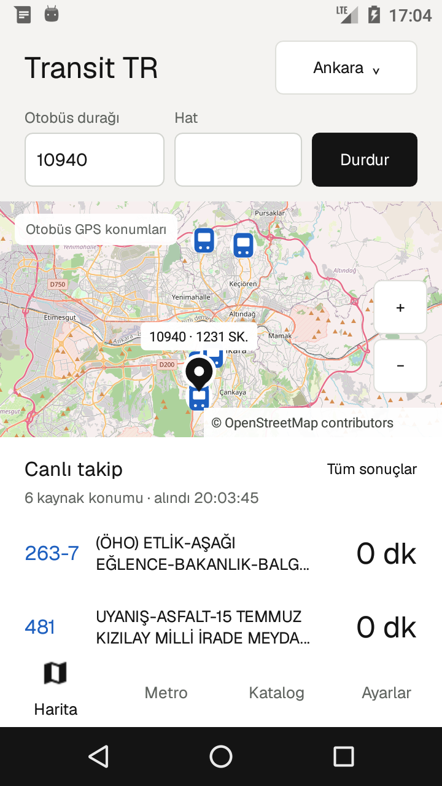
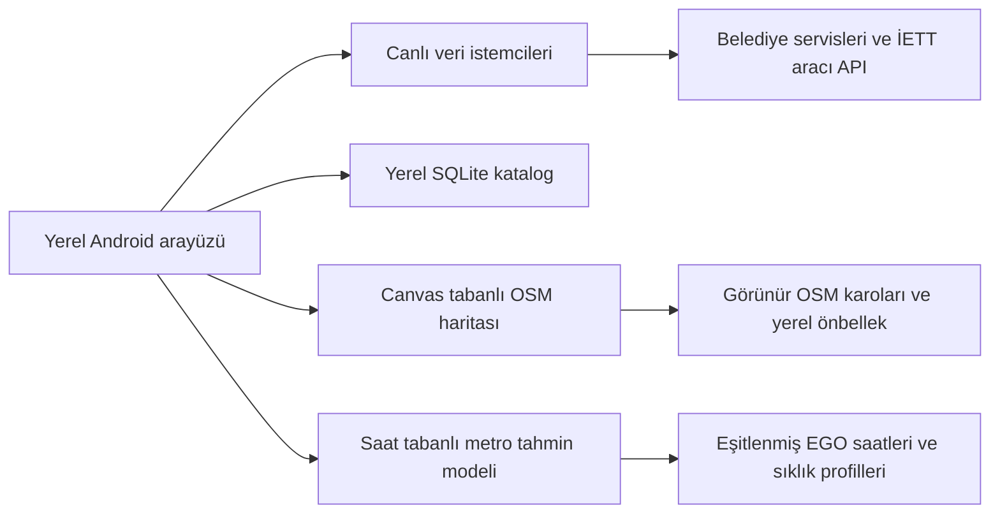

# Transit TR

Android 6+ ve Android 2.2 için yerel toplu taşıma uygulaması. OpenStreetMap üzerinde otobüs konumlarını, durakları ve hat rotalarını gösterir. Ankara ve İstanbul için ayrı metro haritası ve saate dayalı tren konumu tahminleri sunar. WebView veya Google Play Services gerektirmez.

**Sürüm: 1.1.0** · [Kaynak kod](#kaynak-kod) · [Kurulum](#kurulum) · [Test raporu](docs/TEST-REPORT-v110.md) · [Lisans](LICENSE)



## Özellikler

- **Canlı otobüs takibi:** kaynağın sağladığı GPS konumları, varış dakikaları veya kalan durak sayısı.
- **Seçili durak işareti:** girilen durak numarasının koordinatı varsa haritada adı ve numarasıyla siyah pin gösterilir. Durak değiştirilince eski işaret ve sonuçlar temizlenir.
- **Aynı haritada renkli rota:** canlı listedeki mavi hat numarasına dokununca ilgili hat çizilir. Durak işareti korunur; üstteki rota etiketine dokunarak çizgi temizlenebilir.
- **Kaydırılabilir varış listesi:** kaynaktan gelen tüm hatlar ve araçlar aşağı kaydırılarak görülebilir.
- **Yeni katalog:** ana uygulama içinde Hatlar, Duraklar ve Kaydedilenler; arama, yıldızla kaydetme, yakın duraklar ve kaydırarak yeni sonuç yükleme.
- **Ankara sefer saatleri:** EGO'dan otobüs, metro ve Ankaray saatleri; hafta içi, cumartesi ve pazar sütunları, özel sefer notları ve yenileme.
- **Ayrı metro haritası:** Ankara ve İstanbul hatları, istasyonlar ve saate dayalı tahmini tren konumları.
- **Yerel arayüz:** Geist yazı tipi, açık yüzeyler ve Material harita ikonu. Android 2.2'de daha küçük karo belleği ve tek harita ağ işçisi.
- **OpenStreetMap:** sürükleme, iki parmakla yakınlaştırma, artı/eksi düğmeleri ve görünür karolar için en az 7 günlük önbellek.

Canlı takip ön planda Ankara, İzmir ve Konya için yaklaşık 20 saniyede, İstanbul için yaklaşık 60 saniyede yenilenir. Arka planda takip servisi çalışmaz. Bağlantı hatasında önceki sonuçlar korunur ve yeniden deneme aralığı uzar.
=======
# Transit TR 

Android 6+ ve Android 2.2 için yerel toplu taşıma uygulaması. OpenStreetMap üzerinde belediye kaynaklarından gelen otobüs konumlarını, Ankara ve İstanbul metro/istasyon ağını gösterir. WebView veya Google Play Services gerektirmez.

## Özellikler

- **Canlı harita:** Ankara EGO durak sorgusundan GPS ve varış dakikaları; İstanbul İETT hat sorgusundan GPS konumları. İstanbul durağının dakika sonuçları “Tüm sonuçlar” bölümündedir; GPS konumu dakika tahminine çevrilmez.
- **Metro:** Ankara M1–M4 ve Ankaray (5 hat, 54 istasyon kaydı); İstanbul 19 raylı hat, 250 istasyon kaydı, M11 dahil. Hat seçme, istasyon listesi ve istasyona odaklanma.
- **OpenStreetMap:** sürükleme, iki parmakla yakınlaştırma, yakınlaştır/uzaklaştır, görünür alan için karo önbelleği ve kaynak atfı.
- **Hızlı yerel arayüz:** Geist yazı tipi, sade açık yüzeyler, Material harita ikonu. Android 2.2’de daha küçük karo belleği ve tek ağ işçisi.
- Harita açıkken 20 saniyede yenileme; arka planda takip servisi yoktur. Hata sırasında önceki konumlar korunur ve yeniden deneme aralığı uzar.
- **Katalog:** Ankara, İstanbul, İzmir ve Konya hat/durak arama, favoriler, yerel yakın durak ve mevcut tarife ekranları.
- **Diğer canlı sorgular:** İzmir yaklaşan araç/kalan durak ve Konya varış bilgileri. İzmir harita GPS desteği vardır; bu sürümün gerçek GPS harita testi Ankara ve İstanbul’da yapıldı. Konya harita GPS katmanı yoktur.

Metro için ayrı bir harita bulunur. **Tren konumları saate dayalı tahmindir, GPS değildir.** Ankara’da EGO’nun iki yöndeki hafta içi/cumartesi/pazar kalkış çizelgeleri; İstanbul’da yayımlanan yolculuk süreleri ve sıklık modeli kullanılır. İstanbul’daki pik sıklık gün boyunca sabit kabul edilir; M11’in 10 dakikalık sıklığı model varsayımıdır. İstasyon arası süre mesafeye oranlanır, ara duraklarda 20 saniye bekleme varsayılır. M1–M2–M3, Ankara’da birleşik Koru–OSB koridoru olarak hesaplanır; seçilen etaptaki tahmini trenler gösterilir. Model ayrıntıları ve kaynaklar **Model** düğmesindedir. Gecikme, iptal, ek sefer ve resmî tatil değişiklikleri hesaba katılmaz. İstasyonlar arası çizgiler temsili bağlantıdır; gerçek ray geometrisi veya aktarmalı rota hesaplaması değildir. İstasyon sayıları veri kümesindeki ad/koordinat kayıtlarını ifade eder. Yerel ağ/katalog anlık hizmet kesintilerini takip etmez.
>>>>>>> ecb1baefdb77d54e9c43373c0eb279c304d4c407

## Kurulum ve kullanım(releases kısmındadır)

<<<<<<< HEAD
| Şehir | Canlı bilgi | Hat haritası |
|---|---|---|
| Ankara | EGO durak/hat sorgusundan GPS ve varış dakikaları | EGO'nun sıralı durakları ve bilinen OSM koordinatlarıyla şematik bağlantı |
| İstanbul | İETT filo GPS'i ve seçilen durağa ait kaynak dakikaları | İETT / Otobüsüm Anlık güzergâh geometrisi ve hat durakları |
| İzmir | ESHOT / İZTEK GPS'i ve kalan durak sayısı | ESHOT'un yayımladığı otobüs güzergâh geometrileri |
| Konya | ATUS varış bilgileri | Mevcut GTFS güzergâh geometrileri; canlı araç GPS katmanı yok |

Kaynakta dakika bulunmadığında GPS konumu veya kalan durak sayısı dakikaya çevrilmez. Hat rotası bir aracın o anda bulunduğu konumu ifade etmez.

Ankara çizgileri **şematiktir**; koordinatı eksik duraklarda çizgi kesilir. Konya GTFS verisi 2025 tarihlidir ve sonradan değişen hatları içermeyebilir. İzmir ve Konya'da bazı geometrilerin sıralı durak listesi bulunmaz. Her durak için koordinat veya her hat için çizilebilir rota garantisi yoktur. [Veri ve API kaynakları](docs/SOURCES-v1.md).

### Ankara kataloğu ve saat eşitleme

7 Kasım 2026 veri hazırlığında:

- EGO'nun **665 hat/yönü** eşitlendi; 34.657 günlük kalkış girdisi ve 52.079 sıralı durak girdisi alındı. Kaynak 20 hat için saat yayımlamıyor.
- **10.866 Ankara durak kaydının 6.501'inde koordinat** bulunuyor. EGO adları ile OSM koordinatları birleştirildi; eski favori kimlikleri korundu.
- İzmir'in resmî CSV verilerinden **11.983 otobüs durağı ve 892 hat/yön geometrisi** eklendi.

Ankara hat ekranındaki **Sefer saatleri → EGO'dan yenile** ile tek hat güncellenebilir. **Ayarlar** bölümünden tüm EGO hatları eşitlenebilir. Kaynak saatinin yanındaki özel başlangıç ve durak notları korunur; bağlantı hatasında önceki kayıt kullanılır ve belirtilir.

### İstanbul'da dakika ve GPS

Hat alanı boşken seçilen durağın yaklaşan araçları listelenir. Hat girildiğinde harita hattın filosunu, **Durağa varış** listesi ise yalnız seçilen durak ve hatta ait kaynak dakikalarını gösterir. Filo GPS kaydı dakika yerine yazılmaz.

Hat seçilen durağa uğramıyorsa bu açıkça belirtilir ve **Hat durağı seç** düğmesi açılır. Örneğin `500T`, `224672` Kadıköy Çarşı durağına uğramaz; `205471` durağıyla sorgulanabilir. Sol üstteki **Yön** menüsünden gidiş/dönüş seçilebilir. Rota açıkken üstteki etikete dokunarak önce çizgiyi temizleyin.

Otobüsüm Anlık projesinin MIT lisanslı API sözleşmeleri yerel Java koduna uyarlandı. İETT GPS sorgusunda resmî SOAP servisi önceliklidir; durak varışları, hat durakları, güzergâh ve GPS yedeği için Otobüsüm Anlık API'si kullanılır. Lisans ve uyarlama bilgileri [üçüncü taraf bildirimlerindedir](THIRD-PARTY-NOTICES.md).

### Metro haritası

Ankara M1–M4 ve Ankaray; İstanbul'da M11 dahil 19 raylı hat görüntülenir. Hat ve istasyon seçilebilir, istasyona odaklanılabilir.

**Tren konumları saate dayalı tahmindir, GPS değildir.** Ankara modeli eşitlenen EGO kalkış saatlerini; İstanbul modeli yayımlanmış yolculuk sürelerini ve sıklık varsayımlarını kullanır. Ankara M1–M2–M3 birleşik Koru–OSB koridoru olarak hesaplanır. İstanbul'da pik sıklığın gün boyunca sabit olması, M11 için 10 dakikalık sıklık ve ara istasyonlarda 20 saniyelik bekleme model varsayımlarıdır. Gecikme, iptal ve özel gün değişiklikleri hesaba katılmaz. Ayrıntılar uygulamadaki **Model** bölümündedir; istasyon bağlantıları gerçek ray geometrisi değildir.

## Kurulum
=======
- Android 6+ için `Transit-TR-v1.0-android6-plus.apk` (minSdk 23, targetSdk 28).
- Android 2.2 için `Transit-TR-v1.0-android22.apk` (minSdk 8, targetSdk 8).

İki APK aynı paket kimliğini (`org.transittr`) kullanır; aynı anda kurulmaz. APK’lar test anahtarıyla imzalıdır. Üretim dağıtımında kendi kalıcı anahtarınızı kullanın. Özel anahtar kaynak paketinde bulunmaz. Yeni Android sürümlerinin tamamında ve fiziksel telefonlarda test yapılmadı; Play Store yayını hazırlanmadı.

Şehri seçin, otobüs durağı numarasını yazın ve **Başlat** düğmesine dokunun. İstanbul’da GPS için hat kodunu da girin. Test örnekleri: Ankara `10940`, İstanbul `224672` + `500T`, İzmir `21050`, Konya `27`. Sonuçlar saatin, hattın ve servis erişiminin durumuna göre değişir. Araç veya istasyon işaretine dokunarak ayrıntıları açın. **Metro** sekmesinden hattı ve istasyonu seçin; **Katalog** eski arama ekranını açar.

Konum zamanı kaynak tarafından verilirse ayrıntılarda gösterilir; 3 dakikadan eski zaman damgalı araçlar haritada gri çizilir. Kaynak zamanı bilinmeyen sonuçlar güncel zaman damgası verilmiş gibi sunulmaz. Canlı takibin çalışması için telefon GPS izni gerekmez; “Yakınımda” özelliği cihaz konumunu kullanır.

## Test

Android 2.2/API 8 ARM ve Android 6.0/API 23 x86 emülatörlerinde gerçek Ankara/İstanbul GPS, metro ağı, yenileme ve PSS ölçüldü. Ayrıntılar: [test raporu](docs/TEST-REPORT-v1.md). Testler gerçek servisleri kullanır; boş durak veya servis kesintisi başarısız sonuç üretebilir. Emülatör RAM ölçümü fiziksel cihaz garantisi değildir.

```sh
python tests/catalog.test.py
node tests/core.test.cjs
python tools/run_map_tests.py emulator-5556 --output test-results
adb shell am instrument -w org.transittr.tests/.V09Check
```
>>>>>>> ecb1baefdb77d54e9c43373c0eb279c304d4c407

APK indirmeleri için [Releases](https://github.com/basicos2025/transit-tr/releases) bölümünü kullanın. 1.1.0 dağıtım dosyaları:

<<<<<<< HEAD
| Dosya | Minimum Android | targetSdk |
|---|---|---:|
| `Transit-TR-v1.1.0-android6-plus.apk` | Android 6.0 / API 23 | 28 |
| `Transit-TR-v1.1.0-android22.apk` | Android 2.2 / API 8 | 8 |

Her APK yaklaşık 13,3 MiB'dir. Katalog ilk açılışta sıkıştırılmış paketten diske açılır ve yaklaşık 28,9 MiB ek alan kullanır.

İki APK aynı paket kimliğini (`org.transittr`) kullanır; aynı cihazda ayrı uygulamalar olarak kurulmaz. APK'lar test anahtarıyla imzalıdır. Üretim dağıtımında kendi kalıcı anahtarınızı kullanın. Özel anahtar kaynak paketinde bulunmaz. Android 6+ paketinin tüm yeni Android sürümlerinde ve fiziksel cihazlarda çalıştığı doğrulanmadı; Play Store yayını hazırlanmadı.

## Kullanım

1. Şehri seçin, durak numarasını yazın ve **Başlat** düğmesine dokunun.
2. Tek hat için **Hat** alanını doldurun; desteklenen sorgularda tüm hatlar için boş bırakın.
3. Alt listeyi kaydırarak diğer varışları görün. Mavi hat numarasına dokunarak rotayı açın.
4. Araç veya durak işaretine dokunarak ayrıntıyı görün. **Metro** ve **Katalog** sekmelerinden diğer ekranlara geçin.

| Şehir | Örnek sorgu |
|---|---|
| Ankara | Durak `10940`, hat boş veya `481` |
| İstanbul | Durak `224672`, hat boş; ya da durak `205471`, hat `500T` |
| İzmir | Durak `21050` |
| Konya | Durak `27` |

Sonuçlar saate, sefer durumuna ve servis erişimine göre değişir. Kaynak konum zamanı varsa ayrıntıda gösterilir; 3 dakikadan eski zaman damgalı araçlar gri çizilir. Kaynak zamanı bilinmiyorsa yeni bir konum zamanı üretilmez. Canlı sorgu için telefon GPS izni gerekmez; **Yakınımda** cihaz konumunu kullanır.

## Kaynak kod

[GitHub deposu](https://github.com/basicos2025/transit-tr) üzerinden **Code → Download ZIP** ile kaynak kodu indirebilir veya depoyu klonlayabilirsiniz:

```sh
git clone https://github.com/basicos2025/transit-tr.git
cd transit-tr
```

Hazırlanan sürüm kaynak arşivi `Transit-TR-v1.1.0-kaynak-readme-guncel.zip` adını taşır. APK yerine kaynak ZIP'i açtığınızda aşağıdaki klasörler bulunur:

| Konum | İçerik |
|---|---|
| [android-legacy/src/org/transittr](android-legacy/src/org/transittr/) | Android 2.2 ve Android 6+ tarafından paylaşılan yerel Java kodu |
| [android-legacy/assets](android-legacy/assets/) | Katalog, metro ağı ve eşitlenmiş EGO saatleri |
| [android-tests/src/org/transittr/tests](android-tests/src/org/transittr/tests/) | Emülatör, canlı sorgu ve bellek kontrolleri |
| [tools](tools/) | APK derleme, veri üretme ve test çalıştırıcıları |
| [data](data/) | Ham veriler, kaynak özeti ve dosya karmaları |
| [web](web/) ve [backend](backend/) | Web/PWA kataloğu ve Go sunucusu |
| [docs](docs/) | Derleme, veri kaynakları, test raporları ve ekran görüntüleri |

Android uygulamasının başlangıç ekranı [TransitActivity.java](android-legacy/src/org/transittr/TransitActivity.java), harita çizimi [OsmMapView.java](android-legacy/src/org/transittr/OsmMapView.java), durak konumu çözümlemesi [StopResolver.java](android-legacy/src/org/transittr/StopResolver.java) içindedir.

### Derleme

[Android derleme rehberi](docs/BUILD-v1.md), gerekli Java/ECJ, Android SDK araçları ve imza anahtarı ortam değişkenlerini açıklar. Java kodu API 8'e karşı derlenir; Gradle ve AndroidX kullanılmaz.

PowerShell'de, rehberdeki ortam değişkenlerini ayarladıktan sonra:

```powershell
# Android 6+
$env:ANDROID_VARIANT='modern'
python tools/build_android.py

# Android 2.2
$env:ANDROID_VARIANT='legacy'
python tools/build_android.py
```

Çıktılar `dist/transit-tr-v1.1.0-modern.apk` ve `dist/transit-tr-v1.1.0-legacy.apk` olur. Verileri ham kaynaklardan yeniden üretmek için `python tools/build_route_data.py` çalıştırın. Test APK'sı üretirken `ANDROID_TESTS=1` kullanılır; normal uygulamaya dönerken bu değişken kaldırılmalıdır.

Web/PWA kataloğu için Go 1.18+ ile `backend` klasöründe `go run .` çalıştırın ve `http://localhost:8080` adresini açın. Yeni yerel harita arayüzü Android APK'larındadır.

## Testler

Android 2.2/API 8 ARM ve Android 6.0/API 23 x86 emülatörlerinde canlı Ankara/İstanbul sorguları, durak işareti, aynı haritada rota, kaydırılan varış listesi, katalog araması/sayfalaması ve EGO saat yenilemesi kontrol edildi. Dört şehir için örnek durak konumu ve rota verisi test edildi. [1.1.0 test raporu](docs/TEST-REPORT-v110.md) senaryoları, PSS bellek ölçümlerini ve kapsam sınırlarını içerir. Emülatör ölçümleri fiziksel cihaz garantisi değildir.

```sh
python tests/catalog.test.py
node tests/core.test.cjs

# Uygulama ve test APK'sını önce emülatöre kurun.
python tools/run_map_tests.py emulator-5556 --test-class RoutePinCheck --output test-results
python tools/run_map_tests.py emulator-5558 --test-class IettCheck --output test-results
```

Canlı testler haricî servislerin o anda yanıt vermesine ve sefer bulunmasına bağlıdır. MapCheck yaşam döngüsü testinde uygulamayı öne getirmek için Python çalıştırıcısının ADB desteği kullanılır.

## Çalışma diyagramı

[](https://gitdiagram.com/basicos2025/transit-tr?utm_source=readme&utm_medium=picture)

## Veri, gizlilik ve lisans

Transit TR bağımsız bir projedir; belediyelerin resmî uygulaması değildir. Kullanıcı hesabı, reklam veya analiz SDK'sı içermez. Canlı sorgular ilgili belediye servislerine ve İstanbul'da kullanılan aracı API'ye; harita istekleri OpenStreetMap sunucularına gider. Yalnız görünür karolar istenir; toplu bölge indirme yapılmaz.

**Bu dağıtımda TLS sertifika ve alan adı doğrulaması kapalıdır; bağlantıda sunucu kimliği doğrulanmaz.**

Kod [Apache-2.0](LICENSE) lisanslıdır. Google Material Icons Apache-2.0, Geist SIL OFL, Bouncy Castle kendi lisansı ve Otobüsüm Anlık uyarlaması MIT kapsamındadır. OSM verileri ODbL; İBB, İzmir ve Konya verileri ilgili veri lisansları kapsamındadır. Veri lisansları kod lisansından ayrıdır. [Üçüncü taraf bildirimleri](THIRD-PARTY-NOTICES.md) ve [kaynak belgeleri](docs/SOURCES-v1.md) dağıtımda korunmalıdır.

## Çalışma yapısı


=======
[Android derleme rehberi](docs/BUILD-v1.md), [veri/API kaynakları](docs/SOURCES-v1.md). Java/ECJ, Android SDK araçları ve kendi imza anahtarınız gereklidir. Gradle veya AndroidX kullanılmaz. `python tools/build_android.py`; Android 6+ için `ANDROID_VARIANT=modern`, test APK’sı için `ANDROID_TESTS=1`.

Web/PWA kataloğunu çalıştırmak için Go 1.18+ ile `backend` klasöründe `go run .` komutunu çalıştırın ve `http://localhost:8080` adresini açın. Bu sürümün yeni yerel harita/GPS arayüzü Android APK’larına eklendi. Önceki sürümlerin ayrıntıları [tarihsel README](docs/README-v09-history.md) içindedir.

## Çalışma diyagramı

[](https://gitdiagram.com/basicos2025/transit-tr?utm_source=readme&utm_medium=picture)

## Veri, gizlilik ve lisans

Resmî olmayan bağımsız projedir; belediyeler tarafından yayımlanmış bir uygulama değildir. Kullanıcı hesabı, reklam veya analiz SDK’sı yoktur. Canlı sorgular belediye servislerine, harita istekleri OpenStreetMap sunucularına gider. Yalnızca görüntülenen karolar istenir; toplu veya çevrimdışı bölge indirme yoktur. Yerel karo önbelleği en az 7 gün yeniden kullanılır.

**Sertifika ve alan adı doğrulaması eski sürüm limitlemelerinden dolayı kapalıdır.** Kesin web güvenliği vaat edilemez.

Kod Apache-2.0. Google Material Icons Apache-2.0; Geist SIL OFL; Bouncy Castle kendi lisansı; OpenStreetMap verileri ODbL, İBB ve İzmir verileri ilgili açık veri lisansları altındadır. Veri lisansları kod lisansından ayrıdır. [Üçüncü taraf bildirimleri](THIRD-PARTY-NOTICES.md) ve [kaynaklar](docs/SOURCES-v1.md) korunmalıdır.

MapCheck arka plan kontrolü sırasında `RESUME_FROM_HOME` durumunu üretir; Python çalıştırıcı ADB ile uygulamayı öne getirir. Bu nedenle yaşam döngüsü kontrolü için çalıştırıcıyı kullanın.
>>>>>>> ecb1baefdb77d54e9c43373c0eb279c304d4c407
