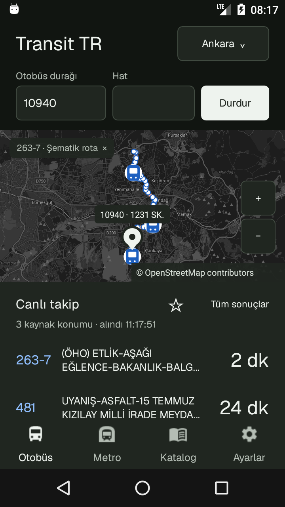

# Transit TR

Android 6+ ve Android 2.2 için yerel toplu taşıma uygulaması; ayrıca bağımsız çalıştırılabilen web arayüzü ve web servisi.

**Sürüm: 1.4.0 — test sürümü.** BursaKart ve ASİS şehirleri, ayrı web kaynak paketi ve 10 MB depolama hedefi.


## Özellikler

- OpenStreetMap üzerinde kaynak otobüs GPS konumları ve seçilen durağa ait varış dakikaları.
- Girilen durağın konumu varsa numarası ve adıyla siyah pin.
- Hat numarasına dokununca aynı haritada renkli rota; katalogda ayrı rota ve sıralı durak ekranı.
- Aşağı kaydırılabilen araç/varış listesi; filo GPS’i ve durak varışları ayrı tutulur.
- Ankara ve İstanbul için ayrı metro haritası, istasyon seçimi ve saate dayalı tren konumu tahmini.
- Hatlar, duraklar, yakın duraklar ve yıldızlı katalog kayıtları.
- EGO otobüs, metro ve Ankaray saatleri; tek hat veya toplu eşitleme, hafta içi/cumartesi/pazar sütunları ve özel sefer notları.
- En fazla 12 durak + hat sorgusu için ana ekran widget’ı. İlk kullanımda örnek hat eklenmez. Android 6+ üzerinde yeniden boyutlandırılır; Android 2.2’de küçük sabit görünüm kullanılır.
- Açık/koyu tema ve ikonlu Otobüs / Metro / Katalog / Ayarlar menüsü.
- WebView, AndroidX veya Google Play Services gerektirmeyen yerel Android arayüzü.

**Metro konumları saat temelli tahmindir; GPS değildir.** Gecikme, iptal ve özel gün değişiklikleri modellenmez. Modeli olmayan raylı hatlarda yalnız istasyon ağı gösterilir. İstanbul’da 26 rota, Ankara’da M1–M4 ve Ankaray bulunur. Ayrıntılar uygulamadaki Model bölümündedir.

## Şehirler ve kaynak desteği

Şehir seçiminde **67 şehir/işletme kaydı** vardır. Bunların 60’ı verilen Akıllı Bilet APK’sının resmî `City` servisinden alınmıştır; listede ilçe, kooperatif ve Nijerya-Uyo kaydı da bulunur. Aydın’ın önceki kimliği korunmuştur. Diğer mevcut şehirler ve Bursa bu listeye eklenir.

| Şehir / kaynak | Canlı bilgi | Rota / katalog |
|---|---|---|
| Ankara / EGO | Kaynak GPS’i ve durak/hat dakikaları | EGO sıralı durakları, OSM koordinatlarıyla şematik bağlantı ve EGO saatleri |
| İstanbul / İETT | Durak dakikaları ve ayrı hat filosu GPS’i | İETT / Otobüsüm Anlık geometrisi ve hat durakları |
| İzmir / ESHOT | Mobil servis hedef durağa saniye cinsinden süre ve GPS verir; yedek kaynak kalan durak sayısı verebilir | Resmî kaynak geometrileri ve duraklar |
| Konya / ATUS | Mobil varışlar ve gerçek araç konumu sorgusu | Mevcut GTFS geometrileri; bu statik verinin tarihi 2025’tir |
| Kocaeli / Kentkart | Durak dakikaları ve GPS | 415 hatlık katalog, çevrimiçi durak araması ve rota |
| Aydın / ASİS | Durak varışları ve seçili hattın ayrı filo GPS’i | 41 hat ve 2.345 duraklık katalog |
| Antalya / Kentkart | Resmî web protokolünün zaman damgalı imzasıyla durak dakikaları ve GPS | 168 hatlık katalog, rota geometrisi ve sıralı duraklar |
| Bursa / BursaKart | Akıllı durak varışları ve bu kayıtlardaki GPS | Çevrimiçi arama, rota geometrisi ve sıralı duraklar |
| Ek ASİS şehirleri | Kaynağın yayımladığı durak varışları ve erişilebiliyorsa ayrı filo konumları | 60 kayıt içinden 32’sinde hat, 13’ünde durak kataloğu alınabildi |

[ASİS şehirlerinin ayrıntılı destek tablosu](docs/ASIS-CITIES-v140.md). Bir şehrin listede veya katalogda bulunması tüm canlı servislerinin çalıştığı anlamına gelmez. Veri alınamayan şehirde araç, dakika veya koordinat uydurulmaz. Bursa’nın ayrı hat filosu servisi testin bir bölümünde HTTP 400 döndürdü; bu durumda seçili durağa ait dakika ve GPS kayıtları korunur.

Ankara rotaları şematiktir: koordinatı bilinen duraklar sırayla kesintisiz bağlanır. Eksik durağa koordinat atanmaz; bu çizgi gerçek yol geometrisi değildir. Kaynakta dakika yoksa GPS veya kalan durak sayısı dakikaya çevrilmez.

## Depolama

Yeni sürümde katalog APK’dan akış halinde okunur; ilk açılışta ikinci bir SQLite kopyası oluşturulmaz. Temel katalogdaki **50.211 kayıt**, kimlikler, tam koordinatlar ve sıralı hat-durak ilişkileri korunmuştur. **665 EGO çizelgesi** bütün sefer notlarıyla tek sıkıştırılmış varlıkta tutulur. Önceki veritabanı kopyası temizlenirken favoriler korunur.

- Ortak harita/çevrimiçi rota önbelleği: en fazla **128 KiB**.
- Güncellenmiş EGO saat arşivi: en fazla **64 KiB**; yenilenen önbellekten çıkarılan kayıt için APK’daki çizelge korunur.
- En fazla 200 yıldızlı katalog kaydı ve 12 widget sorgusu.
- APK yaklaşık **5,5 MB**. Android’in ART/Dalvik dosyaları ayrıca ölçülür.

Android 6 emülatöründe APK, ART, veri ve önbellek dahil sistem ölçümü yaklaşık **9,75 MB**, dolu önbellek rezerviyle yaklaşık **9,83 MB** çıktı. Android 2.2 depolama testi de 10.000.000 bayt sınırının altında geçti. Bunlar test edilen emülatörlerin ölçümleridir; başka Android sürümlerinin ürettiği derlenmiş kod boyutu değişebilir. [Güncel test raporu](docs/TEST-REPORT-v140.md).

## Kurulum

| Paket | Minimum sürüm | targetSdk |
|---|---|---:|
| `Transit-TR-v1.4.0-android6-plus.apk` | Android 6.0 / API 23 | 28 |
| `Transit-TR-v1.4.0-android22.apk` | Android 2.2 / API 8 | 8 |

İki paket aynı `org.transittr` uygulamasını kullanır; aynı cihazda ayrı uygulamalar olarak kurulmaz. Test anahtarıyla imzalanırlar; özel imza anahtarı kaynak paketine dahil değildir. Play Store dağıtımı hazırlanmadı. GitHub’a yükleme bu yerel çalışma tarafından yapılmaz.

## Kullanım

1. Şehri seçip durak numarasını girin, Başlat’a dokunun.
2. Tek hat için Hat alanını doldurun; desteklenen sorgularda tüm hatlar için boş bırakın.
3. Listeyi kaydırın; mavi hat numarasına basarak rotayı çizin.
4. Durak ve hattı birlikte widget’a kaydetmek için yıldızı kullanın.
5. Metro, Katalog ve Ayarlar ekranlarından ağ, sefer saati ve tema seçeneklerine ulaşın.

| Şehir | Örnek |
|---|---|
| Ankara | `10940`, hat boş veya `481` |
| İstanbul | `205471`, hat `500T` |
| İzmir | `21050` |
| Konya | `27` |
| Kocaeli | `80163` |
| Antalya | `12406`; rota `VL13` |
| Bursa | `3368`; rota `19E` |
| Balıkesir | `3074`; kaynakta o anda bulunan varışlar |

Kaynak sonuçları saate ve sefer durumuna göre değişir. Kaynak konum saati varsa ayrıca gösterilir; veri alınma saati GPS ölçüm saati yerine yazılmaz. Eski veya yenilenemeyen sonuçlar belirtilir. Android harita takibi arka planda durur; widget için sistemin izin verdiği kısa yenileme işleri çalışabilir.

## Ayrı web sürümü

`Transit-TR-Web-v1.4.0-kaynak.zip` Android araç zincirinden bağımsızdır. Node.js 22+ ile, `web-service` klasöründe:

```sh
node server.mjs
```

http://127.0.0.1:8080 adresini açın. Runtime için npm paketi kurulmaz. [Web servisi rehberi](web-service/README.md).

Web’de canlı otobüs GPS/dakika haritası, durak pini, renkli rota, katalog, Ankara/İstanbul metro tahmin haritası, tema, EGO saat eşitleme, planlı kalkışlar, duyurular ve favori kutuları bulunur. Favori kutuları masaüstünde boyutlandırılabilir; **Android launcher widget’ı yalnız APK’dadır**. Web’de canlı sorgu ve metro tahmin hesabı sunucu bağlantısı gerektirir; sıkıştırılmış statik şehir katalogları sınırlı çevrimdışı önbelleğe alınır. İlk açılışta örnek favori eklenmez.

## Kaynak kod ve derleme

| Klasör | İçerik |
|---|---|
| `android-legacy/src/org/transittr` | İki Android sürümünün paylaştığı Java arayüzü ve veri istemcileri |
| `android-modern/src/org/transittr` | Modern widget iş zamanlayıcısı |
| `android-legacy/assets` | Sıkıştırılmış katalog, raylı ağ ve sefer saatleri |
| `android-tests` | Emülatör, canlı sorgu, widget ve depolama testleri |
| `web` | Güncel web arayüzü: `live-app.js`, `map.js`, `sw-v140.js` |
| `web-service` | Bağımsız Node HTTP/API servisi ve paketlenmiş veri |
| `tools` | Derleme, veri dışa aktarımı ve test çalıştırıcıları |
| `docs` | Kaynaklar, destek tablosu ve test günlükleri |

[Android derleme rehberi](docs/BUILD-v1.md) ortam değişkenlerini açıklar. Java/ECJ, Android SDK aapt/R8/zipalign/apksigner ve kendi imza anahtarınız gerekir. Gradle ve AndroidX kullanılmaz. Modern pakette API 26+ platform jar gerekir; testte API 34 kullanıldı.

```powershell
# Sıkıştırılmış varlıkları ham kaynaktan yeniden üretmek için:
python tools/build_stream_catalog.py
python tools/export_web_data.py

# Rehberdeki ortam değişkenlerini ayarladıktan sonra:
$env:ANDROID_VARIANT='modern'
python tools/build_android.py
$env:ANDROID_VARIANT='legacy'
python tools/build_android.py
```

Çıktılar `dist/transit-tr-v1.4.0-modern.apk` ve `dist/transit-tr-v1.4.0-legacy.apk` olur. Test APK’sında `ANDROID_TESTS=1` kullanılır; normal derlemede bu değişken kaldırılmalıdır. `backend` ve eski `web/app.js` / `core.js` dosyaları önceki Go/PWA prototipine aittir; güncel web servisini `web-service/server.mjs` çalıştırır.

## Testler

```sh
python tests/stream_catalog.test.py
node --test web-service/test/*.test.mjs
# Web servisi açıkken, Playwright geliştirme bağımlılığıyla:
node tests/web.test.cjs
# Uygulama ve test APK’sını önce emülatöre kurun:
python tools/run_map_tests.py emulator-5558 --test-class ExpandedCitiesCheck --output test-results
python tools/run_map_tests.py emulator-5556 --test-class StorageCheck --output test-results
```

Emülatör ve gerçek Edge tarayıcısı testleri, kaynak sonuçları ve kapsam sınırları [test raporundadır](docs/TEST-REPORT-v140.md). Tüm ASİS şehirlerinde canlı GPS doğrulandığı iddia edilmez.

## Veri, gizlilik ve lisans

Transit TR belediyelerin resmî uygulaması değildir. Hesap, reklam ve analiz SDK’sı bulunmaz. Sorgular ilgili işletmeci servislerine ve İstanbul’da kullanılan aracı API’ye; harita istekleri OpenStreetMap’e gider. Konum izni yalnız yakın duraklar içindir. Kart bakiyesi veya ödeme hizmeti bulunmaz.

**Bu sürümde TLS sertifika zinciri ve sunucu alan adı doğrulaması açıktır.** Eski Android sürümlerinde açıkça paketlenmiş güven kökleri kullanılır; sunucunun gönderdiği bir kök kendiliğinden güvenilir sayılmaz.

Kod [Apache-2.0](LICENSE) lisanslıdır. Material Icons, Geist, Bouncy Castle ve Otobüsüm Anlık bildirimleri [THIRD-PARTY-NOTICES.md](THIRD-PARTY-NOTICES.md) dosyasındadır. Belediye/işletmeci verilerinin lisansları kod lisansından ayrıdır; OSM verileri ODbL kapsamındadır. Verilen APK’lar, decompile edilmiş üçüncü taraf kodu ve native binaryleri dağıtım kaynak paketine dahil edilmez; ulaşım protokolleri yeni Java/JavaScript istemcilerinde uygulanmıştır.

## Yayıncı, bağımsız forklar ve sorumluluk

Yayıncı: Ata Köse — atakose2012@gmail.com. [Gizlilik ve kişisel veriler](docs/PRIVACY-TR.md) · [Kullanım ve sorumluluk bildirimi](docs/TERMS-TR.md).

Bağımsız forklar, değiştirilmiş/yeniden imzalanmış APK’lar ve üçüncü kişilerin dolandırıcılık, kimlik avı veya diğer hukuka aykırı kullanımları onaylanmaz. Hukuken izin verilen en geniş ölçüde, yayıncının/katkıcıların kontrolü dışındaki bu ürünler ve bağımsız fiiller için sorumluluk üstlenilmez. Kasıt, ağır kusur ve kanunen kaldırılamayan sorumluluklar saklıdır. Bu bildirim Apache-2.0 haklarını daraltmaz ve eksik sağlayıcı izninin yerine geçmez.

İlk açılışta gizlilik ve sorumluluk bildirimi birlikte açılır. “Okudum, devam et” ile bir defalık cihaz/tarayıcı kaydı tutulur; kapanış, çıkış veya bildirim yükleme hatası okundu sayılmaz. Metin Ayarlar’dan tekrar açılabilir. Uygulama/site verileri temizlenirse yeniden gösterilir. Bu kayıt açık rıza veya haklardan feragat değildir. Sürüm adı ve numarası değişmedi.
